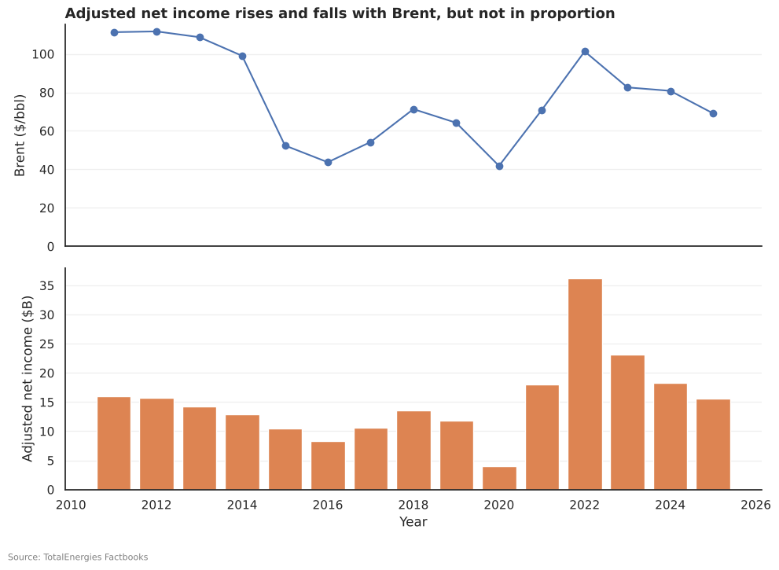
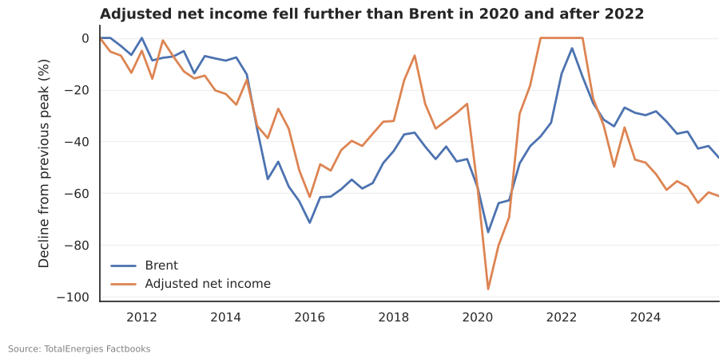
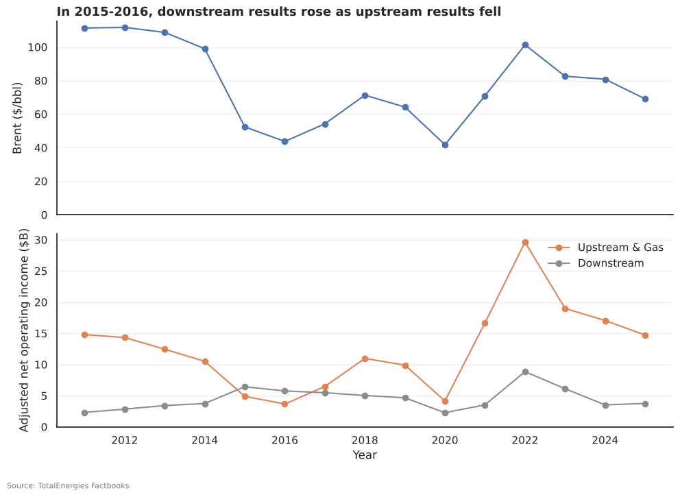

# TotalEnergies and the price of oil

How much do TotalEnergies' results depend on the price of Brent crude, and how much do they fall when oil prices drop? An exploratory analysis of 15 years of official data (2011-2025), built from the company's annual Factbooks.

## Context

I started this project in 2026, when fuel prices in France were very high. The war involving Iran and the disruption of oil tankers through the Strait of Hormuz had pushed crude prices up, and I wanted to understand how much of what we pay at the pump comes from the price of crude oil itself, independently of French fuel taxes.

Taxes are set by the state, but the price of crude is set on the world market, and it is the main source of revenue for oil companies. So I looked at the question from the other side: for a major producer like TotalEnergies, how closely do results follow the Brent price, and how vulnerable is the company when that price falls? The data stop in 2025, so this project does not measure the 2026 shock itself: it studies the mechanism over the previous 15 years, including three major downturns (2014-2016, 2020 and after 2022).

## Questions

**Main question:** to what extent do TotalEnergies' results depend on the Brent price, and how much do they fall when oil prices drop?

1. Do the results follow the Brent price?
2. How much is a higher oil price worth?
3. What does the company lose when oil prices fall?
4. Does the downstream business (refining, chemicals, marketing) cushion falling oil prices?
5. Why do net income and adjusted net income diverge in some years?

## Key findings

1. **Results depend on Brent, but not proportionally.** Sales follow Brent almost perfectly (correlation 0.96), adjusted net income only moderately (0.56).
2. **A 10 USD/bbl increase in Brent is worth about USD 1.7 billion a year** in adjusted net income on average over 2011-2025, below the official sensitivity of USD 2.3 billion published by TotalEnergies for its 2025 portfolio.
3. **Each downturn was different.** Adjusted net income fell less than Brent in 2014-2016 (-56% against -70%), but much more in 2020 (-96% against -57%) and after the 2022 peak (-64% against -44%).
4. **Downstream cushioned the 2015-2016 downturn**, when it earned more than upstream, but not 2020, when demand collapsed.
5. **Falling prices also hit net income through write-downs:** asset impairments and inventory effects widened the gap between net and adjusted net income to USD 8.6 billion in 2014 and 11.3 billion in 2020.







The full analysis, with all charts, interpretations and limitations, is in the [notebook](notebooks/01_totalenergies_analysis.ipynb).

## Data

All figures come from official TotalEnergies publications:

- the annual **Factbooks** (Excel versions, 2014 to 2025 editions), published on [totalenergies.com](https://totalenergies.com);
- for a few figures missing from the Factbooks, TotalEnergies' **quarterly press releases** and **SEC filings** (Form 6-K and Form 20-F).

The series were extracted from these documents and assembled into CSV files, then checked: quarterly figures against annual totals, segment results against published group totals, and overlapping years across Factbook editions. These checks revealed an error in the 2019 Factbook (Q4 2015 Brent price) and a few gaps, all documented in [`data/README.md`](data/README.md), along with the definition and source of every column.

| File | Content |
| --- | --- |
| `totalenergies_annual_2011_2025.csv` | One row per year: Brent, sales, net income, adjusted net income, production |
| `segments_annual_2011_2025.csv` | Adjusted net operating income by year and by segment |
| `totalenergies_quarterly_2011_2025.csv` | One row per quarter: Brent, liquids price, net income, adjusted net income |
| `segments_quarterly_2011_2025.csv` | Adjusted net operating income by quarter and by segment |
| `sources_annual.csv`, `sources_quarterly.csv` | Source (document and sheet) of every figure |

## Repository structure

```
├── data/           Datasets and their documentation
├── images/         Charts used in this README
├── notebooks/      Analysis notebook
├── requirements.txt
└── README.md
```

## Run the analysis

Requires Python 3.10 or later.

```bash
pip install -r requirements.txt
jupyter notebook notebooks/01_totalenergies_analysis.ipynb
```

## Tools

Python, pandas, NumPy, Matplotlib, seaborn, Jupyter.

## Note

I used an AI assistant to help me make this project more polished and professional.
